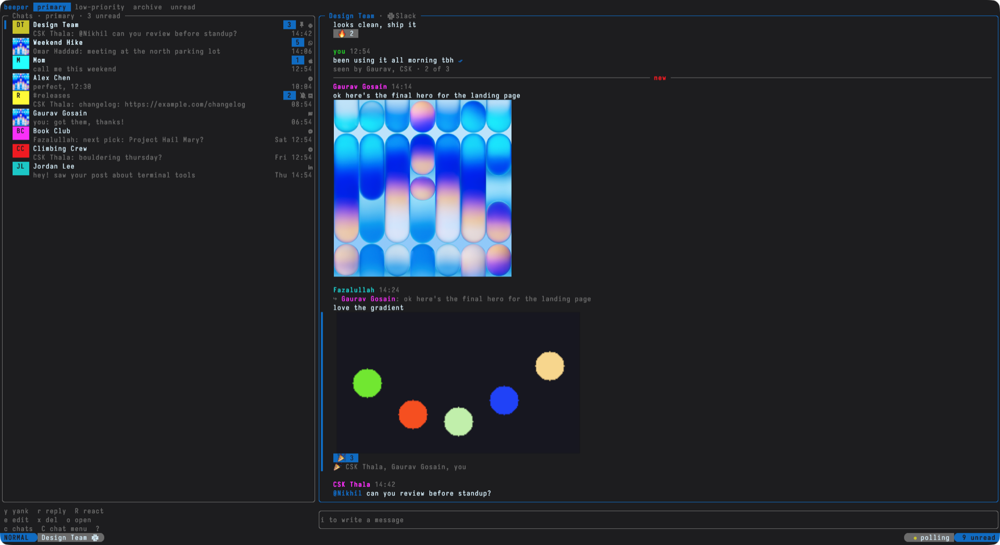
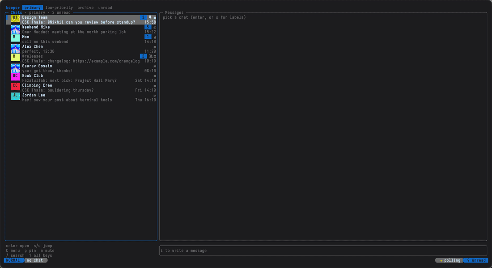
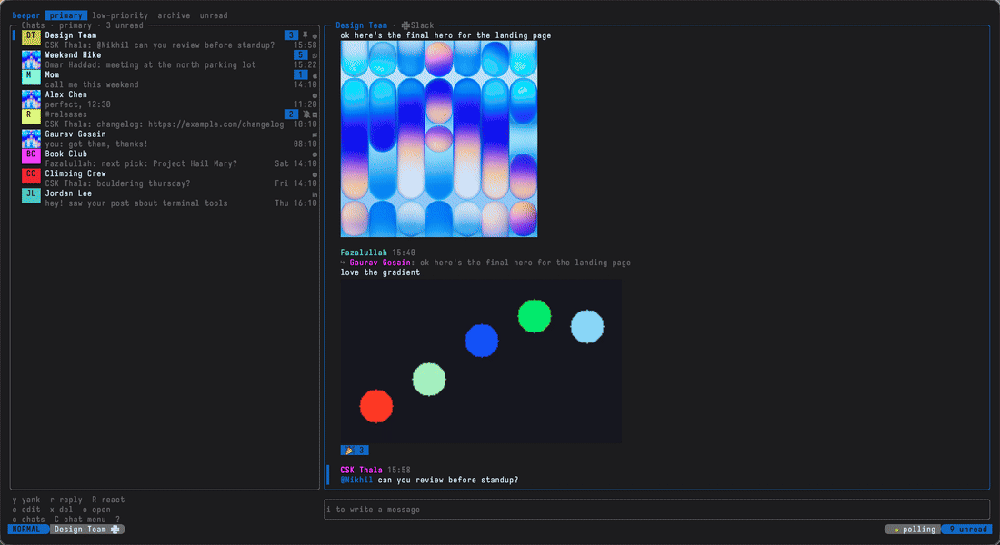
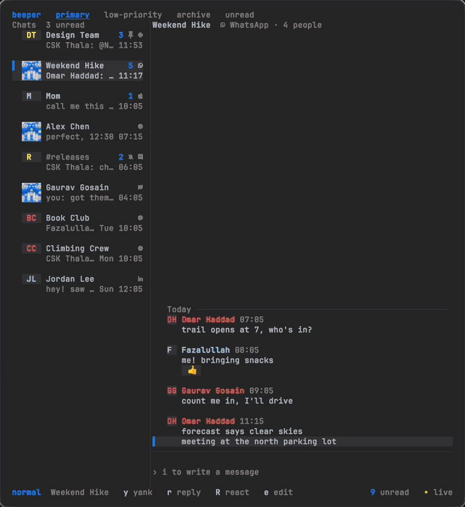
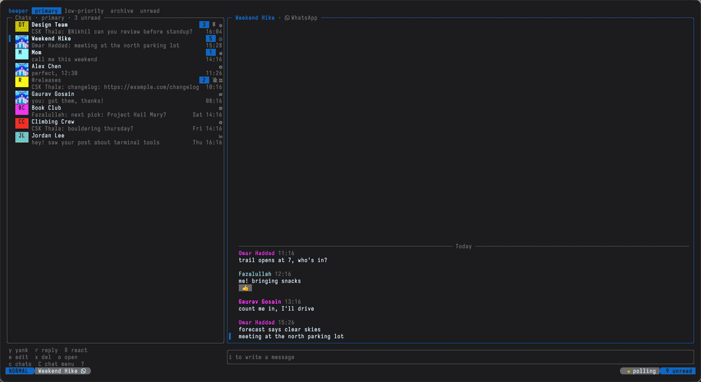
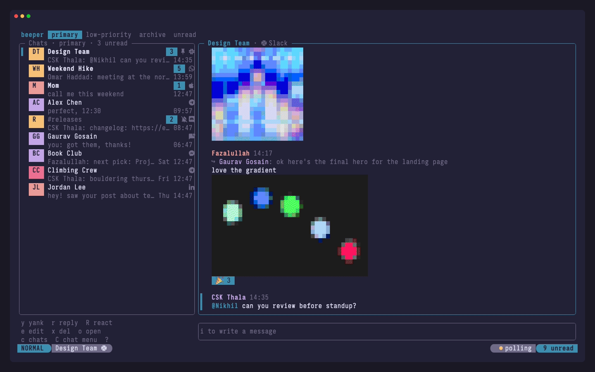
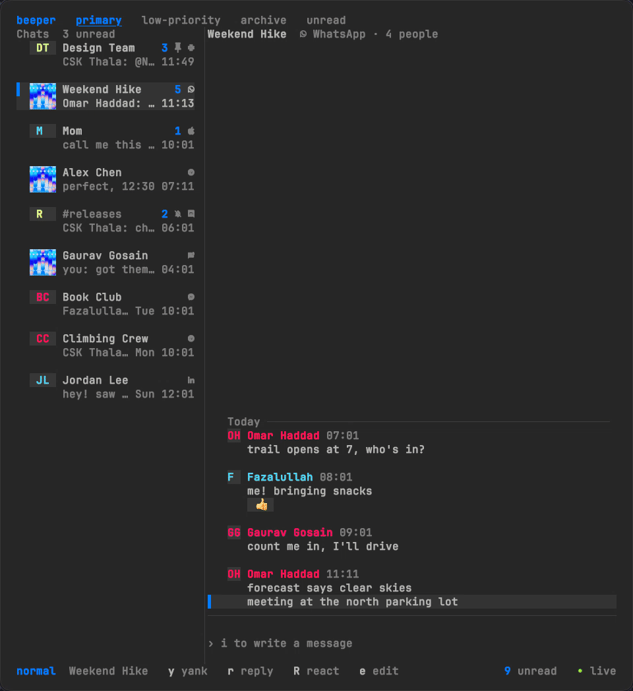
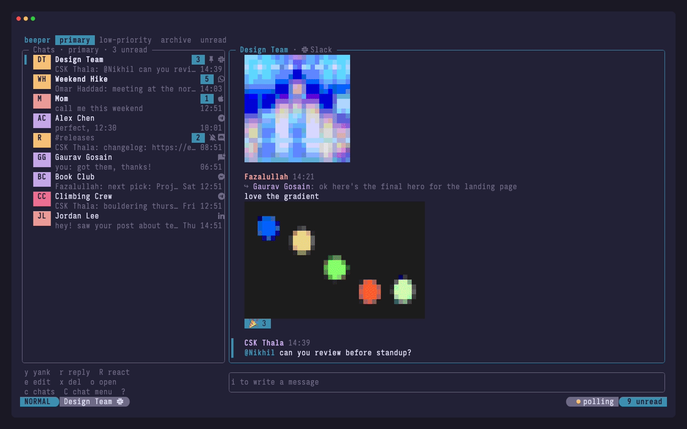

# beepertui

A terminal client for Beeper, talking to the Beeper Desktop app on your machine. Vim-ish keys, and flash.nvim-style labels for picking a chat or message to jump to, yank, reply to, react to, edit or delete.

Works with [tuios](https://github.com/Gaurav-Gosain/tuios) themes and looks: the colours come from your terminal palette, so a tuios look restyles it.

Beeper Desktop does the real work (bridges, encryption). This is just a frontend for its local API on `localhost:23373`.



| | |
| --- | --- |
|  |  |
| Browsing: avatars, sender colours, GIFs that play, who reacted, who saw it | Flash labels: `r` reply, `R` react by emoji name, `yy` yank, `s` jump |
|  |  |
| Media picker: one search across every source, memes captioned live, reaction GIFs | Stickers, cats, xkcd, status codes and Reddit, no keys needed |
|  |  |
| Switching: `cc` fuzzy chat list, `J`/`K`, `c` labels, `C` chat menu | Writing: `@` mentions, multi-line, `:emoji`, `f` link hints, image viewer |
|  | |
| `/` searches inside a chat and jumps to the match, `:` lists every command | |

The clips are recorded with [VHS](https://github.com/charmbracelet/vhs), which can't draw kitty graphics, so images show as blocks there. In Ghostty and kitty they look like the screenshot. Everyone in them is made up: `demo/record.sh` replays the clips against a fake API in `demo/server`.

## Install

```bash
brew install nkapila6/tap/beepertui
```

or

```bash
curl -fsSL https://raw.githubusercontent.com/nkapila6/beepertui/main/install.sh | sh
```

The script drops the binary in `~/.local/bin` (set `BIN_DIR` to change that, `VERSION=0.0.1` to pin). On Windows, grab the zip from [releases](https://github.com/nkapila6/beepertui/releases). With Go installed, `go install github.com/nkapila6/beepertui@latest` works too.

macOS, Linux and Windows all work. On Linux, image paste and yank use `wl-clipboard` (Wayland) or `xclip` (X11), and `C-o` uses `zenity` or `kdialog` when they're installed (otherwise the built-in file browser). Yank falls back to OSC52 if no clipboard tool is around.

## Setup

Turn on the API in Beeper Desktop (Settings > Developers > Beeper Desktop API), then:

```bash
beepertui login
```

That opens Beeper's approval page in your browser. Click approve and the token is saved in the macOS Keychain (or `~/.config/beepertui/token` on Linux and Windows). After that, `beepertui` just starts, and it'll run the login itself the first time if you skip this. `beepertui logout` forgets and revokes the token, and `beepertui status` shows what it's using.

`BEEPER_ACCESS_TOKEN` still works and wins over the saved token if you'd rather manage it yourself. `BEEPER_URL` overrides the API address.

## Keys

| key | does |
| --- | --- |
| `j` `k` `gg` `G` `C-d` `C-u` | move |
| `h` `l` `tab` | switch between chats and messages |
| `J` `K` | next / previous chat, from either pane |
| `enter` | open chat / start writing |
| `i` `a` | write. `enter` sends, `shift+enter` (or `alt+enter`, `C-j`) for a new line, `esc` leaves, `C-v` pastes an image, `C-c` clears, `@` mentions someone, `:joy` (or `C-e`) adds emoji |
| `s` | flash jump anywhere: labels every chat and message on screen at once |
| `c` | flash just the chats and switch to one, from either pane |
| `f` | link hints: every link on screen gets a label, pick one, then `o` opens it in the browser or `y` yanks it |
| `cc` | chat list popup: every chat across all inboxes, type to fuzzy filter, `enter` opens (no match searches all of Beeper). Also `:chats` |
| `C` | flash a chat, then a one-key menu: open, pin, mute, archive, low priority, read/unread, remind, info. `CC` = current chat |
| `y` `r` `R` `e` `x` `o` `U` | flash pick, then yank / reply / react / edit / delete / open / unreact |
| `v` `d` | flash pick, then view the image big / download the attachment to `~/Downloads` |
| `enter` on an image | image viewer: `d` download, `o` open, `n`/`p` next and previous image, `esc` close |
| `yy` `rr` `RR` ... | same thing on the message under the cursor |
| `p` `m` `L` `A` `u` `!` | pin, mute, low priority, archive, read/unread, reminder |
| `O` | jump to this chat (or message) in Beeper Desktop |
| `n` `N` | new DM, new group |
| `[` `]` | cycle inbox: primary, low-priority, archive, unread |
| `/` | in the chat list: filter chats. In a chat: search that chat's messages and jump to one (also `:find`) |
| `:` | command line: a panel lists every command as you type, `↑↓` picks, `tab` completes |
| `C-r` | refresh |
| `q` | quit |

`?` opens the full key reference, split by pane, with the pane you're in highlighted. The bottom-left corner always shows a short cheat sheet for whatever has focus.

## Mouse

Hover over a message's reactions to see who reacted (selecting a message shows them too). Click a chat to open it, click a message to select it (click an image again to view it), click a link to open it, click an inbox tab to switch, click the compose box to write. Right-click a chat or message for a menu of everything you can do with it. The wheel scrolls chats, messages, and images in the viewer. Mouse capture means you need shift (or option, depending on your terminal) to select text. `:mouse off` turns it off, or set `BEEPERTUI_MOUSE=off`.

## Mentions

Type `@` while writing and the chat's members pop up above the input. Keep typing to filter (surnames work), `tab` or `enter` picks, `C-n`/`C-p` move, `esc` hides the list. Picked names go out as proper mentions.

## Images and files

`C-v` (while writing or not) grabs whatever is on the clipboard: a screenshot or copied image goes out as a real photo, and a file copied in Finder, Files or Explorer is attached as is. It has to be `C-v`, because `cmd+v` belongs to the terminal, which only pastes text. Dragging a file into the terminal attaches it too. `:attach <path>` works when you know the path. The next `enter` sends it along with any text.

Images and video posters show inline, and GIFs play. In Ghostty and kitty they're real images, drawn with the kitty graphics protocol. Everywhere else, tmux included, they fall back to chunky half-block thumbnails. HEIC and WebP work too. `o` opens the full thing, and `:images off` hides them. Set `BEEPERTUI_IMAGES=kitty|blocks|off` to override the detection.

`C-o` while writing picks a file (the Finder dialog on macOS, a folder browser elsewhere), and `:files` always gives the in-app browser.

## GIFs, memes and more

`C-g` while writing opens the media picker. It has a tab per source, `tab` switches between them, typing searches the current one, `enter` sends. Each tab has its own command too:

| tab | command | what | key? |
| --- | --- | --- | --- |
| All | `:media` (or `:memeall`) | searches every source at once, grouped | no |
| GIFs | `:gif` | real GIF search via [KLIPY](https://partner.klipy.com) or [GIPHY](https://developers.giphy.com) | free key: `BEEPERTUI_KLIPY_KEY` / `BEEPERTUI_GIPHY_KEY` |
| Memes | `:meme` | 200+ [memegen.link](https://memegen.link) templates, searchable by meaning, captioned with a live preview | no |
| Reactions | `:nekos` | anime reaction GIFs from [nekos.best](https://nekos.best) by mood: laugh, cry, wave, facepalm... | no |
| Stickers | `:emoji` | [Emoji Kitchen](https://emojikitchen.dev) mashups: `:emoji skull laugh` | no |
| Cats | `:cataas` | cat pictures and GIFs from [cataas.com](https://cataas.com), with optional text on them | no |
| xkcd | `:xkcd` | comics by number or title | no |
| Status | `:status` | HTTP codes as cats and dogs ([http.cat](https://http.cat), [http.dog](https://http.dog)) | no |
| Reddit | `:memeapi` | a subreddit's top memes via [meme-api.com](https://meme-api.com) | no |

Tenor's API shut down in 2026, so real GIF search needs a free KLIPY or GIPHY key. Everything else works out of the box.

## Forwarding

`F` + label (or `FF`, or right-click > forward) picks a chat and sends the message there. Beeper's API has no real forward, so it goes out as a fresh message from you, with attachments re-uploaded.

## Reacting

`R` opens an emoji picker:

- `1`-`6` send a quick one (thumbs up, heart, laugh, wow, sad, pray).
- Type to search by name: `fire`, `tada`, `+1`, `:eyes:`. Your recent picks show up first.
- Paste any emoji and press enter.
- Text that matches no emoji, or anything sent with `alt+enter`, goes out as a text reaction. Other Beeper clients display it as is.

Commands worth knowing: `:search <words>` searches every message across every network, `:attach ~/file.pdf` stages a file for the next message, `:remind 2h`, `:expiry 24h` for disappearing messages, `:label`, `:accounts`, `:info`.

## Config

Settings live in `~/.config/beepertui/config.toml`. Edit it by hand, or:

```bash
beepertui config                      # everything, with where each value comes from
beepertui config set accent magenta
beepertui config set image_size large
beepertui config unset accent
beepertui config edit                 # opens $EDITOR
```

Inside the app, `:set` lists the settings and `:set compact true` changes one live and saves it. You can set `nerd_font`, `images`, `image_size`, `avatars`, `compact`, `mouse`, `notifications`, `chat_width`, `inbox`, `accent`, `gif_provider` and `beeper_url`. Env vars like `BEEPERTUI_NERDFONT` still win over the file. Font and font size belong to your terminal, not the app, so set those in kitty/Ghostty/etc.

## Looks

Senders get their own colour, days get a divider, and there's a `── new ──` line where you left off. Your messages show a ✓ when sent and ✓✓ once seen. Your latest message always says who's seen it (`seen by Priya, Sam · 2 of 3`), any of yours shows the same when you scroll onto it, and hovering the ✓✓ lists everyone with times. Chats show their avatar: the real one in Ghostty and kitty, coloured initials elsewhere.

With a [Nerd Font](https://www.nerdfonts.com) installed, set `BEEPERTUI_NERDFONT=1` (or `:icons on`) to get network logos, nicer status icons and a lualine-style status line. `:avatars`, `:compact` and `:images` toggle the rest.

## Themes and tuios

tuios colours and looks are supported. There are no hardcoded colours. Everything uses your terminal's 16 ANSI colours and its default text colour, so it picks up whatever theme you run, light ones included. That makes it tuios compatible: apply a look (`tuios look apply tuios.dev/r/19000274`) and the app restyles with it. Inline images work inside tuios too. tuios forwards kitty Unicode placeholders and tells panes they're on Ghostty when the host terminal can draw them, so you get real images in a tuios pane on Ghostty or kitty, and half-block thumbnails otherwise.

## Notifications

New messages notify you through the terminal: kitty, Ghostty, WezTerm, iTerm and tuios turn them into real system notifications when beepertui is in the background, and a toast pops up in the corner when it's in front but you're in another chat. Muted chats and the chat you're reading stay quiet. `notification_preview = false` hides the message text, and `notifications = false` turns them off (handy if you'd rather keep Beeper Desktop's own notifications).

## Storage

Nothing is stored. beepertui doesn't read Beeper's database or keep a cache. Every chat and message comes from Beeper Desktop's local API (HTTP plus a websocket for live updates) and lives in memory until you quit. The only files it writes are temp images it deletes again, and downloads you ask for in `~/Downloads`. Downloads also pop a toast, plus a desktop notification in Ghostty, kitty, iTerm, WezTerm and tuios.

## Not in here

Connecting new networks and verifying devices still happen in Beeper Desktop itself. They're one-off setup flows with QR codes and login pages that don't make sense in a terminal. `:accounts` shows which ones need attention, and enter on one brings Beeper to the front.

Live updates come over a websocket. iMessage doesn't send events, so everything also refreshes every 30 seconds.
